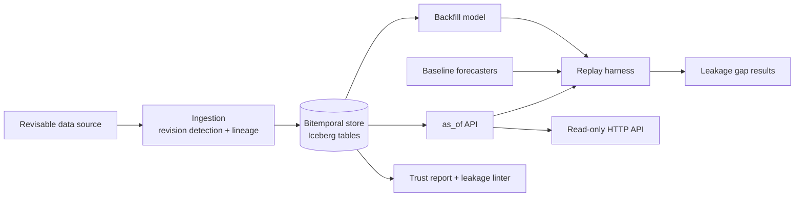

# Architecture

Status: planned design. Components are implemented branch by branch; see
[ROADMAP.md](ROADMAP.md).

## Data flow

## Components

| Package | Responsibility |
|---------|----------------|
| `storage` | Bitemporal model, `as_of` queries, store contract with a reference implementation |
| `ingestion` | Source clients, raw-response archive, revision detection, lineage log |
| `replay` | Real-time and hindsight runs, scoring (WIS, error, coverage), leakage gap |
| `forecast` | Baseline forecasters (seasonal naive, ETS, gradient boosting), see [BASELINES.md](BASELINES.md) |
| `experiment` | The leakage-gap and backfill-recovery experiments: runners, block-bootstrap statistics, report files, see [EXPERIMENT.md](EXPERIMENT.md) |
| `backfill` | Vintage table, the median-revision-by-age correction, and a wrapper that corrects any forecaster's history (ADR 0010) |
| `audit` | Trust report per dataset and a linter that flags look-ahead in user pipelines |
| `api` | Read-only HTTP API over `as_of` queries |

## Design rules

- **One contract, several implementations.** The store contract is defined first and tested
  against a simple in-memory reference implementation. The Iceberg-backed store must pass the
  same contract tests.
- **`knowledge_time` is data, not metadata.** It is an explicit column (see
  [ADR 0002](adr/0002-bitemporal-time-model.md)).
- **Every reported number has a command.** Experiments are scripts, not notebooks, and their
  outputs are reproducible from a single entry point.
- **Add dependencies when first used**, with the reason in the PR.

## Compute

The planned workload is CPU-only: baselines are classical models and gradient boosting, and
queries run in DuckDB. No GPU, Colab or Kaggle resources are required for this project.
If a later experiment needs them, the notebook, its pinned requirements and the exact export
step are documented in the PR that introduces it.

## Decisions

Architecture decisions are recorded in [docs/adr](adr).
