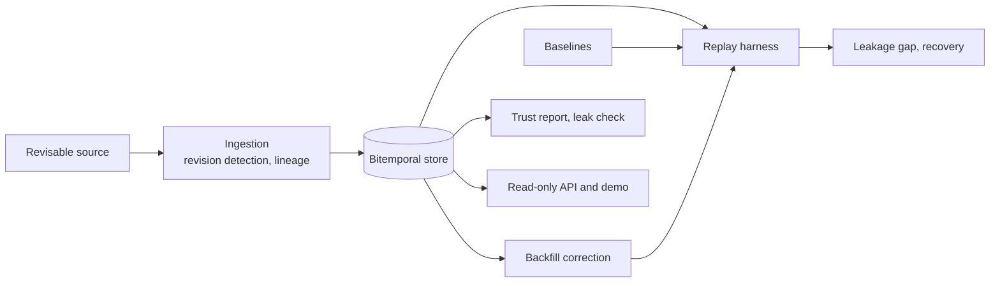

# vintage-lakehouse: technical report

*Version 0.1.0. Every number in this report comes from a command in this repository and is
written in a document next to it; the sources are named in each section.*

## 1. Summary

Many public series are revised after they are first published. A forecaster who must predict
today has only today's provisional numbers, but a model evaluated on the final, revised numbers
sees information that did not exist at forecast time, and so looks better than it would have been
in real time. This project builds the data layer and the evaluation harness to measure that
overstatement, and uses them on one real series.

What was built:

- a **bitemporal store** with an exact `as_of(t)` query, defined by one contract and implemented
  twice (in memory, and on Apache Iceberg with DuckDB);
- **revision-aware ingestion** of the Delphi FluView weekly influenza series, with a raw-response
  archive and a lineage log;
- a **replay harness** that forecasts every origin twice, from what was known then and from what
  is known now, and scores both against the same truth;
- an **experiment** with block-bootstrap confidence intervals, and a **backfill correction** that
  tries to recover part of the gap in real time;
- a **trust report** for a dataset's revisions, a **leak check** and a lint for look-ahead in
  pipelines, a read-only **HTTP API with a time-slider demo**, and **benchmarks**.

What was found, on US national weighted influenza-like illness (873 weekly periods, 51,676
stored versions), with three untuned baselines:

1. Evaluating on revised data **does overstate skill, but modestly and unevenly**: 6.4% lower
   weighted interval score (WIS) for ETS [1.3%, 10.0%], 2.6% for gradient boosting [0.7%, 4.9%],
   and no measurable difference for seasonal naive (0.2% [-0.2%, 0.6%]).
2. A **simple backfill correction did not recover the gap.** It made ETS worse (-9.3% [-15.4%,
   -1.8%]) and had no detectable effect on gradient boosting (+0.4% [-1.2%, 1.8%]). The reason is
   that the source's first-release bias is not stationary: it was about +10% in 2011 to 2013 and
   close to zero from 2015.
3. A **dataset trust report flags that drift by itself**, without any forecast being run, which
   suggests that describing revision behaviour should come before correcting for it.
4. For the store: an Iceberg `as_of` query on the real series takes about 53 ms. Query time grows
   with the number of commits rather than with the data read (the same 781,000 versions answer a
   latest-release query in 389 ms as 100 commits and in 107 ms as one), and keeping a full
   snapshot at every release would need 7.3 times as many rows as keeping the versions.

Two of these results are negative or modest, and they are reported as they are. The scope is one
series, one country's surveillance system and three simple models; section 8 lists what that
excludes.

## 2. The question

> By how much does hindsight evaluation overstate real-time forecast skill, and how much of that
> gap can be recovered by modelling data revisions?

Definitions (full protocol in `docs/RESEARCH_QUESTION.md`):

- **event_time** is the period a value describes; **knowledge_time** is when the source made that
  version available. A revised value has a later knowledge_time than the one it replaces.
- **`as_of(t)`** returns, for each event_time, the latest version whose knowledge_time is at or
  before `t`: exactly what a forecaster could have seen at `t`.
- At a **forecast origin** `t`, the **real-time** forecast sees `as_of(t)`. The **hindsight**
  forecast sees the same periods (up to the latest one reported at `t`) with the values known at
  a later evaluation time `T_eval`. Both are scored against the same truth, the value of each
  target at `T_eval`, so a difference in score comes only from the information available when the
  model was fitted.
- The **leakage gap** is `(WIS_realtime - WIS_hindsight) / WIS_realtime` over matched pairs (same
  model, origin and horizon). Positive means hindsight evaluation flatters the model. It can be
  negative, and the report always gives the absolute difference too.

Three hypotheses were stated before the experiments: **H1** the gap grows with the size of
revisions, **H2** it differs between model classes, **H3** a backfill-aware correction recovers a
measurable part of it. A gap near zero, or a correction that does not help, was declared a valid
result in advance.

## 3. System



**Time model (ADR 0002).** An observation carries `event_time`, a timezone-aware UTC
`knowledge_time`, and an optional `ingest_time`. When a source gives only a publication date, the
version is treated as known from the start of the *next* day, which can delay when a value counts
as known but never advance it, so `as_of` cannot leak a value that was not yet available.

**Store contract (ADR 0005).** `append`, `as_of` and `revisions`. Appending the same version is a
no-op, a conflicting version raises, and a batch is atomic. An in-memory reference store and an
Iceberg store (PyIceberg for the table, DuckDB for the "latest version per period" window query)
pass the same contract tests, including property tests against a brute-force oracle and checks
that microsecond timestamps and exact floats round-trip.

**Ingestion (ADR 0004, 0006).** The source is the Delphi Epidata FluView endpoint (CDC data):
national weighted ILI, epiweeks 2010 to 2026, publications up to issue 202638. A full pull took 17
requests and about 66 seconds anonymously, and returned 51,677 rows, 15,694 of them revisions.
Every response is archived raw under its SHA-256, with a JSON-lines lineage log, so the store can
be rebuilt offline. This matters because the legacy endpoint is being retired: it already refuses
queries for times after 2026-09-22. The dataset identifier of the results below is the hash of the
raw responses.

**Replay (ADR 0007).** Real-time and hindsight histories are built from the store and nothing
else. A property test checks that the real-time history never contains a version known after the
origin, and a hand-computed series with a known first-release bias checks the whole chain (WIS,
truth, pairing, gap).

**Baselines (ADR 0008).** Seasonal naive (a season back), ETS with a damped trend, and gradient
boosting on lagged values with quantile regression. They share quantile levels, a lower bound of
zero and non-crossing quantiles, are deterministic, and are deliberately untuned: they differ in
how much they lean on the latest, most provisional values.

## 4. Experiment design

The analysis plan was fixed in an ADR before the experiment ran (ADR 0009): 137 origins every four
weeks from 2015-01-03 to 2025-06-28, horizons 1 to 4 weeks, primary `T_eval` 2026-09-23 (the last
date the legacy API serves), and a **moving-block bootstrap over origins** (blocks of 12 weeks,
2,000 resamples, seed 0) because nearby origins are strongly correlated. Every statistic is
recomputed on the same resample, so comparisons between models keep their correlation. Secondary
analyses were fixed too: sensitivity to `T_eval`, exclusion of the pandemic window, differences
between models, and a split by the size of recent revisions. They are exploratory, with no
p-values and no correction for multiple comparisons.

For H3 (ADR 0010) a correction wraps any forecaster and rewrites the last four reported weeks by
their typical revision (the median settled-over-provisional ratio at each age), estimated only
from what was known at each origin. The settings were fixed in advance, with two variants
(additive, and a placebo that applies the factors to the wrong ages) and an explicit definition of
"recovery". A 2012 to 2014 development window was used only for smoke tests, and its warning (the
correction hurt ETS there) was written into the ADR before the evaluation origins were run.

## 5. Results

### 5.1 The leakage gap (`docs/RESULTS.md`)

| Model | WIS real time | WIS hindsight | Gap [95% CI] |
|-------|---------------|---------------|--------------|
| seasonal naive | 0.4758 | 0.4748 | 0.2% [-0.2%, 0.6%] |
| ETS | 0.2749 | 0.2573 | 6.4% [1.3%, 10.0%] |
| gradient boosting | 0.2486 | 0.2422 | 2.6% [0.7%, 4.9%] |

- **H2 holds in a limited way.** Seasonal naive, which looks a season back at long-settled values,
  differs from both others (-6.2% [-9.8%, -1.1%] against ETS, -2.4% [-4.6%, -0.5%] against
  gradient boosting). ETS and gradient boosting cannot be told apart (3.8% [-1.6%, 7.2%]).
- **H1 is only partly supported.** For ETS the gap is concentrated where recent revisions were
  largest (13.1% in the top third of origins, against 1.6% and 2.3%), but the rank correlation
  between revision size and per-origin degradation is weak, 0.10 [-0.10, 0.24].
- **Robust to the checks that were run.** Excluding 2020-03 to 2021-09 changes nothing noticeable
  (ETS 6.3%, gradient boosting 2.4%). Block lengths from 4 to 52 weeks give intervals of practically
  the same width. The gap is the same at four evaluation times because influenza data settles
  quickly (hindsight scores differ for only about 3% of targets), which also means this grid cannot
  say what happens with a hindsight time only weeks after each origin.

### 5.2 The backfill correction does not recover the gap (`docs/RESULTS.md`)

| Model (gap) | Primary correction: improvement in WIS | Relative | Placebo, relative |
|-------------|----------------------------------------|----------|-------------------|
| ETS (6.4%) | -0.0255 [-0.0414, -0.0044] | -9.3% [-15.4%, -1.8%] | 0.8% [-0.7%, 1.9%] |
| Gradient boosting (2.6%) | +0.0009 [-0.0025, +0.0045] | 0.4% [-1.2%, 1.8%] | -0.9% [-2.0%, 0.6%] |

The base models' gaps in this run equal those in 5.1, which checks that both runs score the same
forecasts. The correction made ETS worse at every horizon, and for gradient boosting the point
estimate recovers 14% of its gap but with an interval from -56% to +98%, so it is not evidence.
The placebo does no better, so there is no sign that the machinery works for another reason.

The diagnosis, made afterwards and not part of the plan, is that the revision pattern is not
stationary. The estimate averages over the whole past, and the first-release bias it learns was
about +10% in 2011 to 2013 and is close to zero from 2015, so the correction is wrong in the early
evaluation years (a factor of 1.089 in 2015 against a realised ratio of 0.996). A recent-window
estimate is an obvious follow-up. It was suggested by these results and has not been run, so it
would need its own plan or fresh data to count as evidence.

### 5.3 The trust report sees the drift first (`docs/AUDIT.md`)

Run on the stored series, `vintage-lakehouse audit trust-report` describes how values are revised:
the first release differs from the settled value by 5.1% on average (13.2% at the 90th
percentile), 79.6% of first releases are more than 1% away from their final value, and the median
period takes 641 days from first release to last revision. Its yearly bias table, and a finding
produced by a fixed rule, show the median settled/first-release ratio moving from 1.12 to 1.13 in
2011 and 2012 to 0.975 in 2016 and between 0.99 and 1.02 from 2021, which is the pattern that
defeated the correction. The report states facts and prompts, not verdicts, and its thresholds are
conventions.

### 5.4 Checking pipelines for look-ahead (`docs/AUDIT.md`)

The **leak check** runs a pipeline at each origin on the real data, with every later version
altered, and with every later version removed. A pipeline that uses only what was known at the
origin cannot tell them apart. On the real series a clean example passed at all five origins tried
and an example that reads a snapshot of today's data was flagged at all five. An **AST lint**
(seven rules) is offered as a review aid, and the repository keeps the example it misses (a leak
through a variable), because the check, not the lint, is the test. Run on the project's own
source, the lint reports nine findings, all benign.

### 5.5 Systems measurements (`docs/BENCHMARKS.md`)

One machine (Windows 11, 20 logical cores, 39.7 GiB, local disk; PyIceberg 0.12.0, DuckDB 1.5.6),
one run per number, synthetic data and the real series.

| Measurement | Result |
|-------------|--------|
| Iceberg `as_of`, real series (51,676 versions) | 53 ms median (p95 66 ms) |
| Iceberg `as_of`, 7.8k versions, then 781k versions in 100 commits | 72 ms, then 434 ms |
| Latest-release query on 781k versions: 100 commits against one commit | 389 ms against 107 ms; load 40 s against 4.5 s |
| `append`, Iceberg | 40 to 45 thousand versions per second |
| Whole pipeline from the raw archive | 51,676 versions in 34 s (about 1,500 per second) |
| Snapshot at every release against versions, real series | 377,086 against 51,676 rows (7.3x); Parquet 0.57 MB against 0.19 MB (3.1x) |

The slowdown with table size was a surprise, and it was tracked to the number of commits and data
files, which the planning of a scan has to read, not to the rows returned (about the same in every
case). The one-commit layout was added to the benchmarks so the finding can be reproduced. A
second observation, that Iceberg's default 16-character string statistics defeat file pruning for
long, similar series ids, did not change latency here. The quoted pipeline figure is a single
timing outside the benchmark command, and its split between revision detection and storage was
not profiled.

## 6. Engineering and verification

- **One branch per roadmap item**, from `develop`, merged through pull requests with CI; 14
  branches, with decisions in 13 ADRs and a change log. A pre-commit hook and CI run ruff, mypy in
  strict mode and the tests; both a recent and an older ruff must pass.
- **728 tests** pass at this version. Each store passes one contract suite, with property tests
  (Hypothesis) against an oracle; results are hand-computed on small series where possible, and
  the replay results of the Iceberg and in-memory stores are checked to be identical.
- **Mutation checks, done by hand.** For the main modules, bugs were injected on purpose (off by
  one at a boundary, a mean instead of a median, a look-ahead, a missing guard) and the tests had
  to fail. Every time some survived, a test was added until none did, apart from mutants that were
  equivalent. This was a development practice, not a command in the repository, so it cannot be
  re-run from here.
- **Mistakes found and fixed during the work** are in the history and the ADR addenda: for
  instance a test whose own arithmetic was wrong, an assumption about seasonal naive that the data
  contradicted, a relative-path warehouse that opened only from one folder, and a test run that
  silently skipped tests because a fixture had removed modules from memory.
- **Reproducibility.** The raw archive is the dataset of record, the dataset identifier is a hash
  of it, and each experiment writes a manifest (configuration, library versions, timings). Two
  runs with the same configuration and data give identical CSV files.

## 7. Reproducing

```text
python -m pip install -e ".[dev]"
vintage-lakehouse ingest delphi-fluview --first-year 2010 --last-issue 202638   # or --from-archive
vintage-lakehouse experiment leakage-gap --out results
vintage-lakehouse experiment backfill-recovery --out results/backfill-recovery
vintage-lakehouse audit trust-report --out results/trust.md
vintage-lakehouse benchmark --from-store --out results/benchmarks
vintage-lakehouse serve
```

The ingestion command needs the legacy Delphi endpoint, which is being retired. If it no longer
answers, the raw archive (not committed) is required, and whether the newer API offers the same
per-issue history has not been checked. Results are not committed, because the licence of the data
for redistributing derived results has not been verified. Library versions can change the last digit
of a figure, so figures are quoted to one decimal place.

## 8. Limitations

This section is part of the result. `docs/LIMITATIONS.md` has the full, itemised list; the
important ones are these.

**Scope of the findings**

- **One series, one source.** Everything measured is US national influenza surveillance. The size
  of the gap is not a property of forecasting in general; it depends on how a source revises. No
  claim is made about other diseases, countries or domains, and no Vietnamese data was evaluated.
- **Three simple, untuned models.** Nothing is said about complex models. A model that leans
  harder on the latest values could show a larger gap, and one tuned in hindsight could look better
  than any of these.
- **"Settled" is relative.** The source keeps revising for years (the median period takes 641
  days to its last change), so the truth at `T_eval`, although the most settled available, is not
  final in the strictest sense.
- **A modest, uneven gap.** For these models it is zero to moderate, and the statements about
  model differences and about revision size are exploratory, with no multiple-comparison
  correction.
- **The evaluation-time grid is late.** A hindsight time defined relative to each origin, for
  instance a few weeks later, was not tested.
- **Intervals cover the choice of origins** (block bootstrap), not model misspecification or the
  choice of correction settings. The block length was checked once, outside the repository.

**The correction (H3)**

- The negative result applies to *this* correction: a median revision by age, estimated from all
  the past. It does not show that no correction can work. The recent-window variant suggested by
  the diagnosis was not run, and the correction does not widen the forecast intervals.
- Recovery is a ratio of two noisy quantities, defined only where the model has a gap, and it can
  exceed 100% or be negative.

**The system**

- **Data licence not verified.** The week-0 gate's licence criterion stayed open: Delphi asks for
  citation and the data originates from the US CDC, but the full terms were not read. Derived
  results are therefore not published as files. **The repository has no software licence file yet**;
  that choice belongs to the author.
- **The source is being retired.** Reproducing the data pull depends on the legacy API or on the
  saved raw archive.
- **Single writer, local storage.** Concurrent writers, remote object storage and compaction are
  not handled, and many small commits slow queries (measured).
- **Ingestion reads one period at a time** to detect revisions, which is likely why the pipeline
  is 25 to 30 times slower than a bare append; this was not profiled.
- **The leak check** finds only what its origins exercise, assumes determinism and does not look
  inside models. **The lint** has false positives and false negatives. **The trust report's
  thresholds** are conventions.
- **The API and demo are a demo server**: no authentication, TLS or rate limiting.
- **Benchmarks** are one machine and one run per number.
- **Not checked by the author of this report:** the CI workflow's result on a fresh runner,
  Python 3.12 (the classifiers list it), and DuckDB 2.x for the full test suite (it was checked for
  the Iceberg path only, with Python 3.11).
- **Not an operational system.** It is research and decision-support tooling, not a source of
  official forecasts or warnings.

## 9. What would come next

In order of how much each would change the conclusions:

1. **A second source with heavier revisions** (for example an economic series from ALFRED, which
   needs a personal API key), to see whether the gap, and the failure of a stationary correction,
   depend on the series.
2. **A recent-window or drifting-bias correction**, with its own plan, on fresh data or a held-out
   period, since the present one was suggested by the results.
3. **A hindsight time relative to each origin**, so that the gap can be measured against an *early*
   rather than a fully settled truth.
4. **Store work found by the benchmarks:** compaction, a bulk read of revisions in ingestion, and
   full column statistics. Each needs its own measurement.
5. **A stronger model set**, including models fitted to the revision process itself.

## Appendix: decision records

| ADR | Decision |
|-----|----------|
| 0001 | Record architecture decisions |
| 0002 | Bitemporal time model and the date-only convention |
| 0003 | Storage and query stack (Iceberg and DuckDB), with findings |
| 0004 | FluView as the primary dataset |
| 0005 | Store contract semantics |
| 0006 | Archive raw responses |
| 0007 | Replay protocol |
| 0008 | Baseline forecasters |
| 0009 | Leakage-gap experiment (analysis plan fixed before the run) |
| 0010 | Backfill correction and how its benefit is measured |
| 0011 | Trust report and look-ahead checks |
| 0012 | Read-only API and the demo |
| 0013 | Benchmarks |
